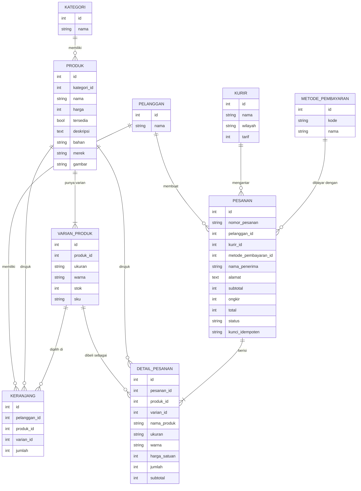

# Dokumentasi API — ME (Toko Online Pakaian & Aksesori)

**Kelompok 2** · Domain: Pakaian dan Aksesori
**Mata kuliah:** Pemrograman Aplikasi Perangkat Bergerak & Sistem Terdistribusi
**Base URL (emulator Android):** `http://10.0.2.2:8000/api`
**Identitas pelanggan (pengujian):** header `X-Pelanggan-Id: 1`

> **Catatan untuk tim (hapus sebelum jadi PDF):** isi dokumen ini disusun dari membaca kode di repo (`routes/api.php`, controller, migration, seeder) dan dari hasil pemanggilan sungguhan terhadap kode tersebut di salinan lokal (SQLite, `migrate:fresh --seed`). Nomor pesanan, waktu, dan id pada contoh di Bagian 3 akan berbeda di laptop kalian. **Jalankan ulang kelima panggilan dari Postman di laptop kelompok dan ganti contohnya** agar sesuai dengan basis data kalian saat dikumpulkan.

---

## 1. Diagram Relasi Antartabel

Sumber: `backend/database/migrations/2026_11_05_000001` s.d. `000009`.



**Tabel khas domain (Pakaian dan Aksesori): `varian_produk`.** Stok disimpan per kombinasi ukuran × warna, dengan kunci unik `(produk_id, ukuran, warna)`. Tabel `produk` tidak punya kolom stok sendiri; angka `stok` pada respons produk adalah jumlah stok seluruh variannya. Dua kolom khas domain pada produk adalah `bahan` dan `merek`, ditambah `ukuran` dan `warna` pada varian.

Tabel `pesanan` memiliki kunci unik `(pelanggan_id, kunci_idempoten)` yang menjadi pagar terakhir terhadap pesanan ganda. Tabel `detail_pesanan` menyalin `nama_produk`, `ukuran`, `warna`, dan `harga_satuan` saat checkout, sehingga riwayat pesanan tidak berubah ketika produk diubah.

---

## 2. Tabel Seluruh Endpoint

Sumber: `backend/routes/api.php`. Seluruh respons memakai pembungkus seragam:

- Sukses: `status` = `"sukses"`, `code`, `message`, `data`.
- Gagal: `status` = `"gagal"`, `code`, `message`, `errors` (berisi pesan per kolom pada 422, selain itu `null`).

| No | Metode & Jalur | Kegunaan | Parameter | Kode status |
|----|----------------|----------|-----------|-------------|
| 1 | GET `/api/produk` | Daftar produk | query `kategori`, `cari` (opsional) | 200 (tetap 200 bila kosong) |
| 2 | GET `/api/produk/{id}` | Rincian produk beserta varian | path `id` | 200, 404 |
| 3 | POST `/api/produk` | Tambah produk beserta varian awal | body: `nama`, `harga`, `kategori`, `bahan`, `merek`, `varian[]` (`ukuran`, `warna`, `stok`); opsional `deskripsi`, `tersedia`, `gambar` | 201, 422 |
| 4 | PUT `/api/produk/{id}` | Ubah produk dan varian | path `id`; body seperti nomor 3, semua opsional (`varian[].id` untuk mengubah varian lama) | 200, 404, 422 |
| 5 | DELETE `/api/produk/{id}` | Hapus produk | path `id` | 200, 404, 409 (masih ada di pesanan aktif) |
| 6 | GET `/api/keranjang` | Isi keranjang beserta subtotal | header `X-Pelanggan-Id` | 200 |
| 7 | POST `/api/keranjang` | Tambah varian ke keranjang | body: `produk_id`, `varian_id`, `jumlah` (≥ 1) | 201, 409 (stok kurang atau produk tidak aktif), 422 |
| 8 | PUT `/api/keranjang/{id}` | Ubah jumlah item | path `id`; body `jumlah` (≥ 1) | 200, 404, 409 (melebihi stok), 422 (nol atau negatif) |
| 9 | DELETE `/api/keranjang/{id}` | Hapus satu item | path `id` | 200, 404 |
| 10 | GET `/api/kurir` | Daftar kurir dan tarif wilayah | tidak ada | 200 |
| 11 | GET `/api/metode-pembayaran` | Daftar metode pembayaran | tidak ada | 200 |
| 12 | POST `/api/checkout` | Buat pesanan dari isi keranjang | header `X-Kunci-Idempoten` (wajib); body: `nama`, `alamat`, `kurir_id`, `metode_pembayaran_id` | 201 (baru), 200 (ulangan dengan kunci sama), 409 (stok kurang atau keranjang kosong), 422 |
| 13 | GET `/api/pesanan` | Riwayat pesanan, terbaru dulu | header `X-Pelanggan-Id` | 200 |
| 14 | GET `/api/pesanan/{id}` | Rincian pesanan beserta item | path `id` | 200, 404 |
| 15 | PATCH `/api/pesanan/{id}/status` | Ubah status pesanan | path `id`; body `status` | 200, 404, 409 (perpindahan tidak sah), 422 |
| 16 | GET `/api/gambar/{filename}` | Berkas gambar produk dari penyimpanan server | path `filename` | 200, 404 |

Soal mewajibkan 14 endpoint. Endpoint nomor 11 (`metode-pembayaran`) dan nomor 16 (`gambar`) adalah tambahan kelompok; keduanya ada di kode dan karena itu didokumentasikan di sini.

Arti kode status pada sistem ini:

- **404** — sumber daya tidak ditemukan. Aplikasi menampilkan keadaan kosong, bukan dialog galat teknis.
- **409** — permintaan bertentangan dengan keadaan server: stok varian kurang, keranjang kosong saat checkout, hapus produk yang masih ada di pesanan aktif, atau perpindahan status tidak sah. Pesan dari server ditampilkan apa adanya.
- **422** — validasi gagal. `errors` memuat pesan per kolom (contoh: `errors.alamat`).
- **500** — galat server. Aplikasi menampilkan pesan umum dengan tombol coba lagi.

---

## 3. Contoh Permintaan dan Balasan Nyata

Semua permintaan memakai header `Accept: application/json`, `Content-Type: application/json`, dan `X-Pelanggan-Id: 1`. Data awal berasal dari seeder (`php artisan migrate --seed`).

### 3.1 Daftar produk — `GET /api/produk?cari=Kaos`

Permintaan: `GET http://10.0.2.2:8000/api/produk?cari=Kaos`

Kode status: **200**

```json
{
  "status": "sukses",
  "code": "200",
  "message": "Daftar produk berhasil diambil",
  "data": [
    {
      "id": 1,
      "nama": "Kaos Polos Oversize Cotton Combed",
      "harga": 89000,
      "kategori": "Pakaian",
      "stok": 55,
      "tersedia": true,
      "deskripsi": "Kaos potongan oversize berbahan 100% katun combed 24s yang sejuk, tebal, dan menyerap keringat dengan baik.",
      "bahan": "Katun Combed 24s",
      "merek": "ME Basics",
      "gambar": "1.jpg",
      "gambar_url": "http://127.0.0.1:8765/api/gambar/1.jpg"
    }
  ]
}
```

`stok` = jumlah stok seluruh varian produk (15 + 8 + 0 + 12 + 20 = 55). `deskripsi` boleh `null`.

### 3.2 Tambah ke keranjang — `POST /api/keranjang`

Permintaan (varian id 4 = ukuran M, warna Putih):

```json
{ "produk_id": 1, "varian_id": 4, "jumlah": 2 }
```

Balasan sukses:

Kode status: **201**

```json
{
  "status": "sukses",
  "code": "201",
  "message": "Item berhasil ditambahkan ke keranjang",
  "data": {
    "id": 2,
    "produk_id": 1,
    "varian_id": 4,
    "nama_produk": "Kaos Polos Oversize Cotton Combed",
    "ukuran": "M",
    "warna": "Putih",
    "harga_satuan": 89000,
    "jumlah": 2,
    "subtotal_item": 178000,
    "gambar": "1.jpg"
  }
}
```

Permintaan untuk varian yang stoknya nol (varian id 2 = ukuran M, warna Hitam), padahal varian lain pada produk yang sama masih tersedia:

```json
{ "produk_id": 1, "varian_id": 2, "jumlah": 1 }
```

Kode status: **409**

```json
{
  "status": "gagal",
  "code": "409",
  "message": "Stok ukuran M warna Hitam habis.",
  "errors": null
}
```

### 3.3 Lihat keranjang — `GET /api/keranjang`

Kode status: **200**

```json
{
  "status": "sukses",
  "code": "200",
  "message": "Data keranjang berhasil diambil",
  "data": {
    "items": [
      {
        "id": 1,
        "produk_id": 1,
        "varian_id": 3,
        "nama_produk": "Kaos Polos Oversize Cotton Combed",
        "ukuran": "L",
        "warna": "Hitam",
        "harga_satuan": 89000,
        "jumlah": 1,
        "subtotal_item": 89000,
        "gambar": "1.jpg"
      },
      {
        "id": 2,
        "produk_id": 1,
        "varian_id": 4,
        "nama_produk": "Kaos Polos Oversize Cotton Combed",
        "ukuran": "M",
        "warna": "Putih",
        "harga_satuan": 89000,
        "jumlah": 2,
        "subtotal_item": 178000,
        "gambar": "1.jpg"
      }
    ],
    "subtotal": 267000
  }
}
```

`subtotal` dihitung server dari `harga_satuan` × `jumlah` setiap item (89.000 × 1 + 89.000 × 2 = 267.000).

### 3.4 Checkout — `POST /api/checkout`

Permintaan, dengan header tambahan `X-Kunci-Idempoten: 5b1d3c1e-7a42-4a8e-9d11-0c6f2f6a9b10`:

```json
{
  "nama": "Budi Santoso",
  "alamat": "Jl. Mawar No. 1, Malang",
  "kurir_id": 1,
  "metode_pembayaran_id": 1
}
```

Balasan sukses:

Kode status: **201**

```json
{
  "status": "sukses",
  "code": "201",
  "message": "Pesanan berhasil dibuat",
  "data": {
    "id": 4,
    "nomor_pesanan": "ORD-20261108-6YJHCQ",
    "status": "menunggu_pembayaran",
    "subtotal": 267000,
    "ongkir": 10000,
    "total": 277000,
    "nama_penerima": "Budi Santoso",
    "alamat": "Jl. Mawar No. 1, Malang",
    "nama_kurir": "JNE Reguler - Dalam Kota (Jabodetabek)",
    "metode_pembayaran": "Tunai di Tempat (COD)",
    "created_at": "2026-11-08 04:07:11",
    "detail": [
      {
        "id": 4,
        "nama_produk": "Kaos Polos Oversize Cotton Combed",
        "ukuran": "L",
        "warna": "Hitam",
        "harga_satuan": 89000,
        "jumlah": 1,
        "subtotal": 89000,
        "gambar": "1.jpg"
      },
      {
        "id": 5,
        "nama_produk": "Kaos Polos Oversize Cotton Combed",
        "ukuran": "M",
        "warna": "Putih",
        "harga_satuan": 89000,
        "jumlah": 2,
        "subtotal": 178000,
        "gambar": "1.jpg"
      }
    ]
  }
}
```

Mengirim ulang permintaan yang sama dengan kunci yang sama menghasilkan kode 200 dan pesanan yang sama (nomor pesanan identik), stok tidak berkurang dua kali, dan tidak ada pesanan kedua.

### 3.5 Rincian pesanan — `GET /api/pesanan/4`

Kode status: **200**

```json
{
  "status": "sukses",
  "code": "200",
  "message": "Rincian pesanan berhasil diambil",
  "data": {
    "id": 4,
    "nomor_pesanan": "ORD-20261108-6YJHCQ",
    "status": "menunggu_pembayaran",
    "subtotal": 267000,
    "ongkir": 10000,
    "total": 277000,
    "nama_penerima": "Budi Santoso",
    "alamat": "Jl. Mawar No. 1, Malang",
    "nama_kurir": "JNE Reguler - Dalam Kota (Jabodetabek)",
    "metode_pembayaran": "Tunai di Tempat (COD)",
    "created_at": "2026-11-08 04:07:11",
    "detail": [
      {
        "id": 4,
        "nama_produk": "Kaos Polos Oversize Cotton Combed",
        "ukuran": "L",
        "warna": "Hitam",
        "harga_satuan": 89000,
        "jumlah": 1,
        "subtotal": 89000,
        "gambar": "1.jpg"
      },
      {
        "id": 5,
        "nama_produk": "Kaos Polos Oversize Cotton Combed",
        "ukuran": "M",
        "warna": "Putih",
        "harga_satuan": 89000,
        "jumlah": 2,
        "subtotal": 178000,
        "gambar": "1.jpg"
      }
    ]
  }
}
```

---

## 4. Cara Server Menghitung Subtotal, Ongkos Kirim, dan Total

Semua perhitungan dilakukan di Laravel; Flutter hanya menampilkan hasilnya.

- **Subtotal** = jumlah dari (`harga` produk saat checkout × `jumlah`) untuk setiap item keranjang pelanggan. Pada `GET /api/keranjang` perhitungan yang sama dipakai untuk menampilkan subtotal sementara.
- **Ongkos kirim** = nilai `tarif` pada baris tabel `kurir` yang dipilih pembeli (`kurir_id`). Tarifnya tetap per kurir/wilayah, bukan dihitung dari berat atau jarak. Data seeder: JNE Reguler / Dalam Kota Rp10.000, SiCepat Kilat / Luar Kota Rp20.000, J&T Express / Luar Pulau Rp35.000. Mengganti kurir mengubah ongkos kirim dan total.
- **Total** = subtotal + ongkos kirim. Pada contoh 3.4: 267.000 + 10.000 = 277.000.

Ketiga nilai disimpan pada kolom `subtotal`, `ongkir`, dan `total` tabel `pesanan`, sedangkan rincian per item (termasuk `harga_satuan`) disimpan di `detail_pesanan`. Karena harga disalin saat checkout, pesanan lama tidak berubah ketika harga produk diubah kemudian.

---

## 5. Aturan Bisnis Khas Domain dan Kode Status Penolakan

**Aturan:** stok dikurangi pada tingkat varian (ukuran × warna). Varian yang stoknya habis tidak dapat dipesan, meskipun varian lain pada produk yang sama atau produk itu sendiri masih tersedia.

**Kode status penolakan: 409 Conflict**, dengan pesan dari server, mis. `"Stok ukuran M warna Hitam habis."`

Penolakan dilakukan server di tiga titik:

1. `KeranjangController::store` (POST `/api/keranjang`) — menolak produk yang tidak aktif (`tersedia = false`), varian yang stoknya nol, dan jumlah (termasuk yang sudah ada di keranjang) melebihi stok varian.
2. `KeranjangController::update` (PUT `/api/keranjang/{id}`) — menolak jumlah baru yang melebihi stok varian.
3. `CheckoutController::store` (POST `/api/checkout`) — memeriksa ulang stok setiap varian di dalam transaksi basis data setelah barisnya dikunci; jika kurang, transaksi dibatalkan penuh dan server membalas 409.

Pembatalan pesanan (`dibatalkan`) mengembalikan stok varian di dalam transaksi yang sama.

---

## 6. Cara Kerja Header `X-Kunci-Idempoten`

1. Flutter membuat satu nilai acak (UUID v4) untuk percobaan checkout dan mengirimnya pada header `X-Kunci-Idempoten`. Nilai yang sama dipakai ulang bila pengguna menekan tombol coba lagi.
2. Server menolak permintaan tanpa header ini dengan 422.
3. Server mencari pesanan milik pelanggan tersebut dengan kunci yang sama. Jika ada, server membalas pesanan itu dengan kode 200 dan **tidak** membuat pesanan baru maupun mengurangi stok lagi.
4. Jika belum ada, server menjalankan seluruh proses dalam satu transaksi basis data: mengunci baris varian (`lockForUpdate`, diurutkan menurut id untuk mencegah deadlock), memeriksa stok, menyimpan pesanan beserta kunci idempoten, menyimpan detail pesanan, mengurangi stok, dan mengosongkan keranjang. Kegagalan di langkah mana pun membatalkan seluruh perubahan.
5. Kunci unik `(pelanggan_id, kunci_idempoten)` pada tabel `pesanan` menjadi pagar terakhir di tingkat basis data.

Skenario yang dilindungi: balasan 201 tidak sampai karena jaringan putus, lalu klien mengulang permintaan dengan kunci yang sama dan memperoleh pesanan yang sama.

---

## 7. Perpindahan Status Pesanan yang Sah

Sumber: `PesananController::$transisiSah`.

| Status saat ini | Dapat berpindah ke |
|---|---|
| `menunggu_pembayaran` | `menunggu_konfirmasi`, `dibatalkan` |
| `menunggu_konfirmasi` | `dibayar`, `dibatalkan` |
| `dibayar` | `diproses` |
| `diproses` | `dikirim` |
| `dikirim` | `selesai` |
| `selesai`, `dibatalkan` | tidak ada (status akhir) |

Urutan normal: `menunggu_pembayaran` → `menunggu_konfirmasi` → `dibayar` → `diproses` → `dikirim` → `selesai`. Status `dibatalkan` hanya dapat dicapai dari dua status pertama. Perpindahan lain, misalnya `selesai` → `diproses`, ditolak dengan **409**:

```json
{
  "status": "gagal",
  "code": "409",
  "message": "Perpindahan status dari 'selesai' ke 'diproses' tidak diizinkan. Status selesai status akhir dan tidak dapat diubah lagi.",
  "errors": null
}
```

---

## Lampiran
- Koleksi Postman: `docs/ME-Kelompok02.postman_collection.json`
